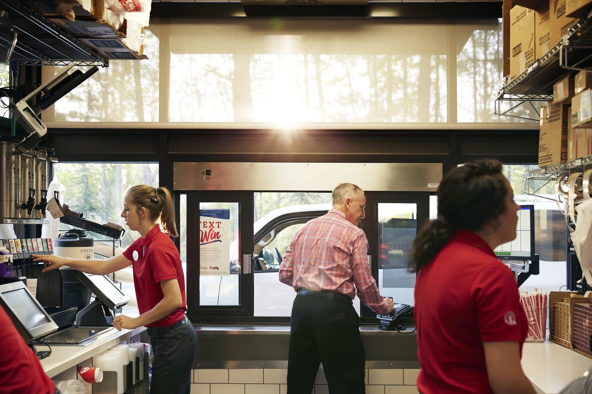

# Chick-fil-A Foothill Ranch — Website

**Live: [cfafoothill.com](https://cfafoothill.com)**

The public marketing site + private team portal for Chick-fil-A Foothill Ranch. Built and deployed for a real, operating store — the team of ~90 uses the portal daily, and guests use the public site for hours, catering, and community info.



## What's here

- **Public site** (`index.html`) — hero, career, community, location & hours, catering.
- **Team portal** (`tm-portal/`) — internal handbook, resources, and a v2 portal experience. URL-gated for team use.
- **Assets** — brand imagery, staff intros, community events.

## Stack

| Layer | Tech |
| --- | --- |
| Frontend | Plain HTML5, CSS, JavaScript — no framework |
| Hosting | Netlify |
| Config | `netlify.toml` (headers, redirects) |

Kept intentionally framework-free — the site is a couple of long-form marketing pages plus a handful of team-portal pages, and vanilla HTML keeps hosting and edits simple.

## Structure

```
├── index.html          # Public marketing home
├── css/                # Stylesheet(s)
├── js/                 # Nav, mobile menu, scroll animations
├── images/             # Photos and assets
├── fonts/              # Custom fonts
├── tm-portal/          # Team portal (handbook + portal-v2)
├── netlify.toml        # Netlify config
├── robots.txt
└── sitemap.xml
```

## Deploy

Netlify auto-deploys from `main`. Local preview:

```bash
python3 -m http.server 8000
open http://localhost:8000
```

## Note

This is production code for a working Chick-fil-A store. Content, brand imagery, and PDFs belong to Chick-fil-A, Inc. and the operator — kept in the repo so the site is fully reproducible, but not licensed for reuse.
